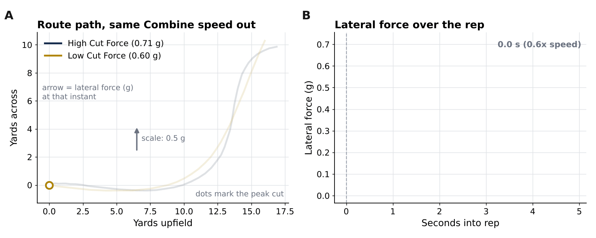

# Cut Force: The Combine Trait the Stopwatch Misses

**NFL Big Data Bowl 2027, Open Track.** Jay R. Kelley, M.S. Applied Data Science (Sports Analytics), IU Indianapolis.

The Combine measures a receiver's route drills with a stopwatch. The stopwatch reports how long a drill took. It does not report how hard a receiver can turn while he is still running fast. **Cut Force** is that number: the peak cornering load a receiver produces at speed, computed frame by frame from the Combine's 10 Hz route-drill tracking as speed multiplied by turn rate, reported in g.

| Question | Answer | Number |
|---|---|---|
| Is it a stable trait? | Yes | split-half reliability 0.59 across nine drills, 967 reps, 107 receivers |
| Is it new information? | Yes | r = 0.06 with the 40, -0.06 with the 3-cone, -0.11 with draft slot |
| Does it carry to NFL routes? | Yes | r = 0.23 on 25,860 breaking routes (82 receivers), about 0.45 after correcting for noise |
| Does it connect to targets? | Qualified yes | +1.9 targets per 100 routes per SD (95% interval 0.5 to 3.4), with Puka Nacua carrying much of it |

Deceleration into the break, acceleration out of it, and speed kept through it were tested the same way. None of the three repeats across drills and carries to games. Only the cut itself does.

## Start here

- **Public Kaggle notebook (runs top to bottom, 13 interactive charts):** https://www.kaggle.com/code/jaykelley/cut-force-the-combine-trait-the-stopwatch-misses
- **The writeup:** [`writeup/writeup.md`](writeup/writeup.md), about 2,000 words plus appendices, with the seven figures in [`writeup/figures/`](writeup/figures/)
- **One-page summary:** [`docs/Kelley_CutForce_OnePage_Summary.pdf`](docs/Kelley_CutForce_OnePage_Summary.pdf)
- **Research brief (course paper, APA):** [`docs/Kelley_CutForce_Research_Brief.pdf`](docs/Kelley_CutForce_Research_Brief.pdf)
- **Interactive companion page:** [`docs/cutforce_companion.html`](docs/cutforce_companion.html) (open in a browser)



*Two receivers run the same Combine speed out. The navy receiver's Cut Force is 0.71 g and the gold receiver's is 0.60 g.*

## What is in this repo

```
notebook/    cut_force_bdb2027.ipynb      the Kaggle notebook (Version 23), organized by the seven Big Data Bowl sections
writeup/     writeup.md + figures/        the competition writeup, figures as submitted
analysis/    *.py, json                   the working scripts behind each section (alignment, features, Bayesian model,
                                          sensitivity, break phases, defensive backs, load, interactive figure builds)
docs/        PDFs, companion.html          one-page summary, research brief, review copy of the writeup, companion page
notes/       working_log.md, review_checklist.md   chronological working notes and the audit trail, numbers in these
                                          are historical; the writeup and notebook carry the final ones
```

## Reproducing it

The notebook runs on Kaggle with the competition dataset attached (about 17 to 20 minutes, mostly the PyMC fit and the Plotly builds). Every number, table and figure in the writeup is printed or written by a cell. The only outside data is the public nflverse Combine release used for Figure 7 and Appendix G.

**The competition data is not in this repo.** It is the NFL's and Kaggle's and cannot be redistributed. Join the competition and attach the dataset: https://www.kaggle.com/competitions/nfl-big-data-bowl-2027

The scripts in `analysis/` were run locally on the same files and expect them under a `data/` folder next to `analysis/`. They are kept for the record; the notebook is the reproducible path.

## Method in one paragraph

Cut Force per frame is speed times the absolute rate of change of travel direction, counted only above 3 yards per second so slow pivots do not look like elite cuts. A rep's score is the mean of the three highest frames around the peak, converted to g, standardized within drill and draft class, then shrunk toward the mean with empirical Bayes. Transfer is tested on regular-season breaking routes adjusted for route type and entry speed. Production is tested with a Bayesian hierarchical logistic regression (PyMC) of target on receiver, route type, alignment, coverage, down, draft slot and weight, treating the Combine score as a noisy measure of a latent trait. Full equations are in Appendix F of the writeup.

## Citation

Kelley, J. R. (2026). *Cut Force: The Combine trait the stopwatch misses.* NFL Big Data Bowl 2027, Open Track. https://www.kaggle.com/code/jaykelley/cut-force-the-combine-trait-the-stopwatch-misses

Data: Lopez, M., Blake, A., Bliss, T., Howard, A., & Mooney, P. (2026). *NFL Big Data Bowl 2027* [Data set and competition]. Kaggle. Historical Combine data from nflverse, courtesy of Pro Football Reference.

## License

Code in this repository is released under the MIT License. The writeup text and figures are © 2026 Jay R. Kelley and may be quoted with attribution.
