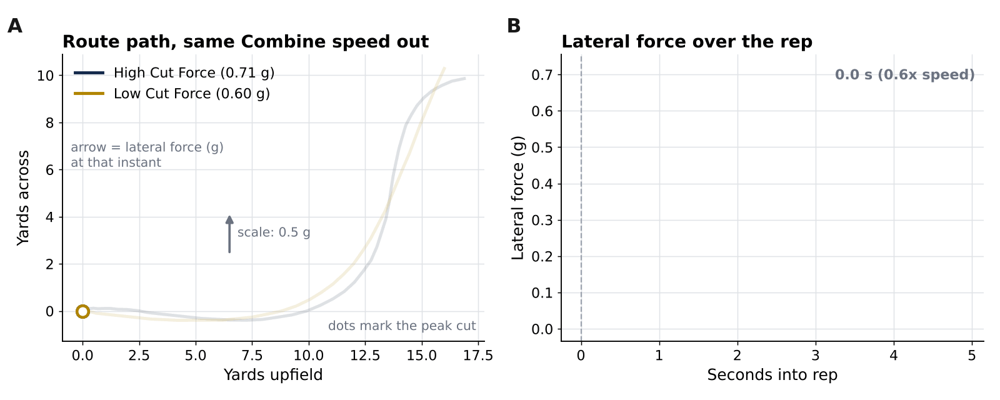
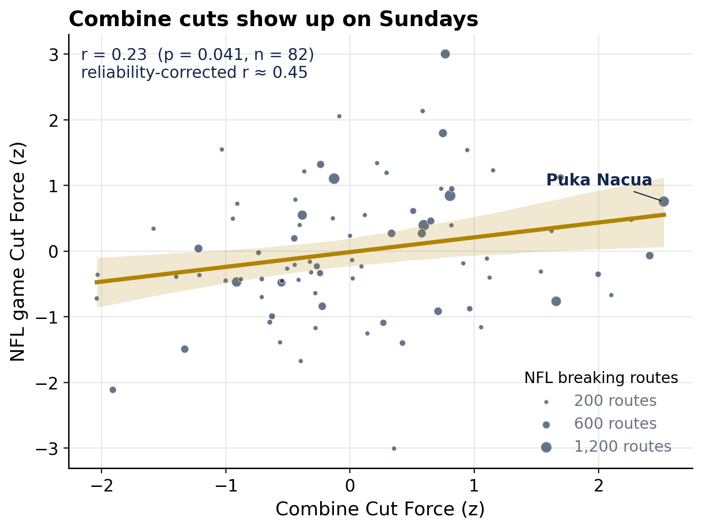
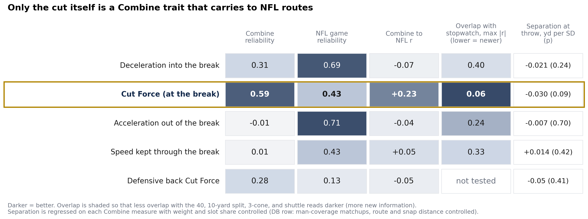
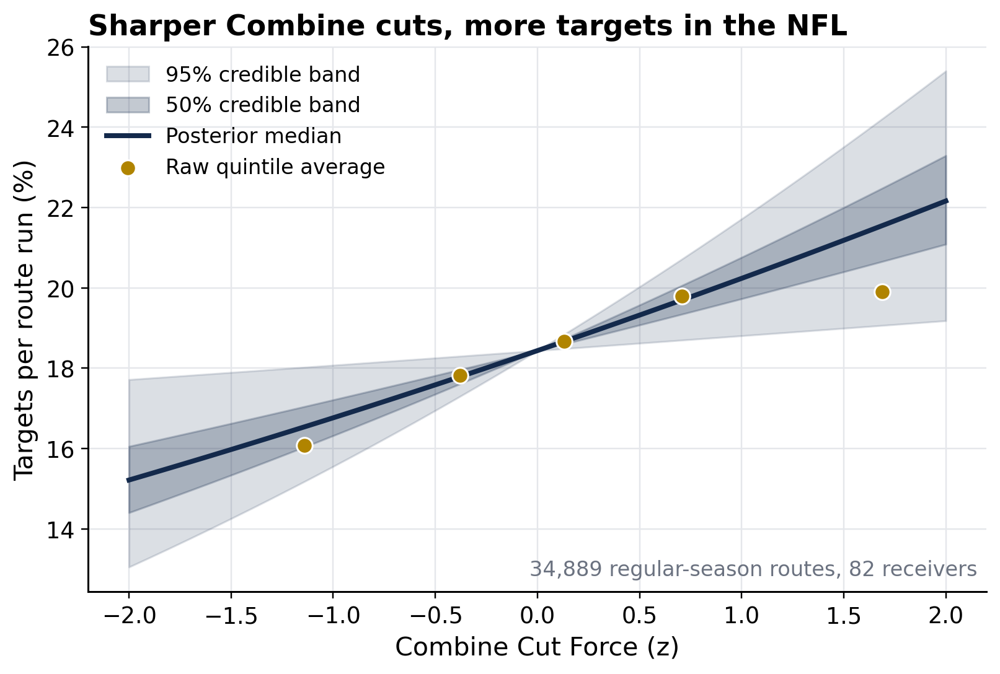
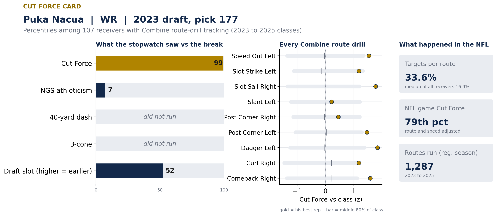
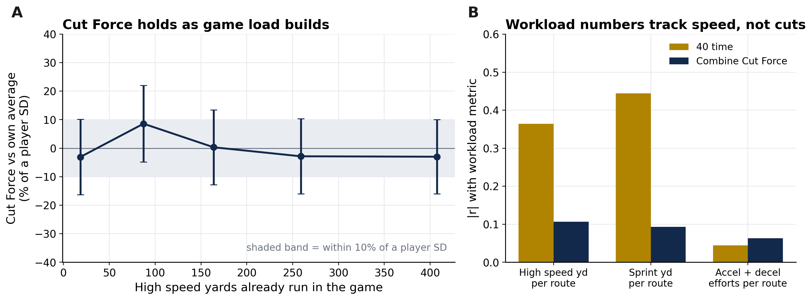
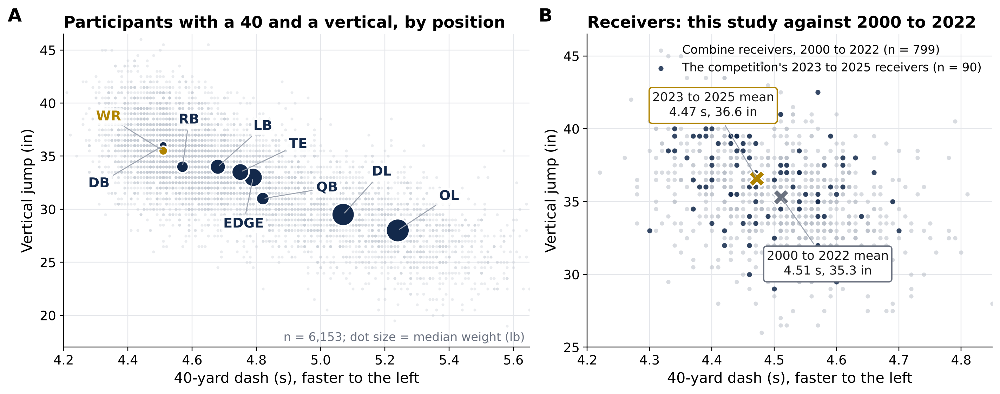

# Cut Force: The Combine Trait the Stopwatch Misses

## 1. Introduction

Much of a receiver's value is decided at the break. The Combine measures that skill with a stopwatch, and the stopwatch only reports how long a drill took. It does not report how hard a receiver can turn while he is still running fast.

The present study introduces **Cut Force**, a tracking-based measure of the peak cornering load a receiver produces at speed during the Combine's 10 Hz route drills (Lopez et al., 2026). The study asks three questions. Is Cut Force a stable trait, does it carry over to NFL routes, and does it connect to how often quarterbacks target that receiver?

The first two answers are yes, and the third is a qualified yes. The highest Cut Force belongs to Puka Nacua, a fifth-round pick and 2025 AP first-team All-Pro (Maaddi, 2026). Receivers with higher Cut Force earn more targets per route after controls, although Nacua carries much of that result.

## 2. Defining Cut Force

A receiver who changes direction has to push sideways against the ground (Dos'Santos et al., 2018). That sideways push produces centripetal acceleration, which equals speed multiplied by the turn rate of the path. Cut Force is therefore computed frame by frame as

$$a_{\perp}(t) = v(t) \left|\frac{d\theta(t)}{dt}\right|$$

where v is speed and θ is the direction of travel in radians. Only frames faster than 3 yards per second count, because slow pivots would otherwise look like elite cuts. Cut Force for one rep is the mean of the three highest frames around the peak, converted to g.

*Figure 1. Two receivers run the same Combine speed out. (A) Route path, with dots at the peak cut. (B) Lateral force across the rep. The navy receiver's Cut Force is 0.71 g and the gold receiver's is 0.60 g.*

Nine Combine route drills (comeback, curl, dagger, both post corners, slant, slot sail, slot strike, and speed out) cover 967 reps from 107 receivers in the 2023 to 2025 draft classes. Each rep is standardized within its drill and draft class, because the 2025 tracking export differs from earlier years. Player scores are then shrunk toward the mean with empirical Bayes (Efron & Morris, 1975), because a receiver with three reps deserves less trust than a receiver with twelve.

## 3. Is Cut Force a Real Trait?

A new metric first has to measure the same thing twice. With about one rep per drill, the study splits each player's drills into two random halves 500 times and correlates the halves. The median Spearman-Brown corrected reliability (Spearman, 1910, and Brown, 1910) is **0.59**, with an interquartile range of 0.55 to 0.65.

A new metric also has to add something, and Cut Force is close to independent of every traditional measure. The 40-yard dash correlates with Cut Force at r = 0.06, the 10-yard split at −0.02, NGS athleticism at −0.03, and weight at −0.13. The 3-cone and short shuttle both reach only −0.06. The stopwatch drills measure total time, while Cut Force measures what happens inside the turn itself.

Draft slot is also unrelated (r = −0.11 with the log of the pick), so teams do not appear to price this skill on draft day.

## 4. Does It Carry Over to NFL Routes?

The same calculation runs on 25,860 regular-season breaking routes (out, in, slant, post, corner, cross, and hitch) from 82 receivers, each measured from the snap to the throw and adjusted for route type and entry speed.

*Figure 2. Combine Cut Force against NFL game Cut Force for 82 receivers. Dot size reflects NFL breaking routes, and the band is a 95% bootstrap interval.*

The correlation between the two is **r = 0.23** (p = 0.041, n = 82). Game Cut Force has its own odd and even route reliability of 0.43, so both measures carry noise. After correcting for both sources (Spearman, 1904), the estimated correlation between the true traits is about **0.45**, although that estimate is imprecise with 82 receivers.

## 5. Brakes, Cut, or Burst?

The prompt asks about deceleration into breaks and acceleration out of cuts, so every rep and route was split into phases around the peak. Deceleration is the peak frame-level deceleration in the second before the peak, acceleration is the peak frame-level acceleration in the second after it, and speed kept is the lowest speed at the break divided by entry speed (formulas in Appendix F).

*Figure 3. Each break phase scored on the same checks. Darker cells are better.*

Only the cut itself works as a Combine trait. Deceleration repeats moderately (0.31) but largely restates the 3-cone (r = 0.40). Acceleration out and speed kept do not repeat across drills at all, even though both are stable in games (0.71 and 0.43). None of the three carries over to NFL routes, and no phase, Combine or game, predicts separation at the throw. In a player-clustered logit for targets per route with all four phases, Cut Force alone keeps its link (odds ratio 1.15, p = 0.016). In these drills only the turn repeats, so braking and burst may be better measured in practice and game tracking.

## 6. Does It Connect to Production?

The study models all 34,889 regular-season routes run by those 82 receivers across three seasons, with an 18.4% target rate.

The main model is a Bayesian hierarchical logistic regression fit in PyMC (Abril-Pla et al., 2023). Routes are grouped by receiver, route type, alignment (slot or outside), coverage type, and down. Draft slot and weight are included because both reflect how teams already value the receiver.

The model treats Combine Cut Force as a noisy measure of a latent trait, with the noise set by the reliability of 0.59, so the slope is not pulled toward zero.

*Figure 4. Model-adjusted targets per route run across the Cut Force range. Bands show uncertainty in the slope, and gold points are raw averages by Cut Force quintile.*

A one standard deviation increase in true Cut Force raises targets per route by **1.9 percentage points**, with a 95% credible interval of 0.5 to 3.4. The posterior probability that the effect is positive is 0.99, and over a 500-route season the effect is worth about nine extra targets. On the measured Combine score, which still carries drill noise, the same step is worth about 1.4 points, or about 7 targets.

A player-clustered logit in statsmodels (Seabold & Perktold, 2010) gives an odds ratio of 1.13 per standard deviation (p = 0.062).

*Table 1. Effect of a one standard deviation increase in Combine Cut Force (regular season).*

| Outcome | Baseline | Effect per SD | 95% interval | Evidence | n |
|---|---|---|---|---|---|
| Targets per route run | 18.4% | +1.9 pts | 0.5 to 3.4 | P(>0) = 0.99 | 34,889 routes |
| EPA per target | 0.165 | +0.066 | −0.017 to 0.149 | p = 0.119 | 6,433 targets |
| YAC over expected (yd per catch) | 0.29 | +0.23 | −0.01 to 0.46 | p = 0.056 | 3,760 catches |
| Offensive snaps per season (log) | 180 (median) | +0.27 | −0.09 to 0.63 | p = 0.144 | 107 players |

Every outcome moves in the same direction. Targets per route is the clearest, and yards after catch comes next, which fits a receiver who is harder to tackle in space.

## 7. What Cut Force Does Not Do

The first limit is separation (Figure 3, p = 0.086, slightly negative). The benefit appears in target share, not in the separation recorded at the throw.

The second limit is specificity. The target effect is nearly identical on breaking routes and go routes (interaction p = 0.88). It is also the same against man and zone coverage, with an odds ratio of 1.13 in each (interaction p = 0.72). Cut Force may therefore capture general body control rather than the skill of beating one defender.

The third limit is prediction on new players. Refit on two draft classes and tested on the third, adding Cut Force did not lower held-out error (log loss 0.4507 without it, 0.4508 with it). Cut Force does track the part of each receiver's target rate that the base model misses (r = 0.33, p = 0.010, n = 62). Nearly all of that signal comes from the 2023 class, the only class with three NFL seasons, so later classes need more seasons. A player-level version of the same test across ten break definitions reaches the same answer for the primary definition. The first-break variant lowers held-out error the most, but only in the 2023 class (Appendix H).

The fourth limit is leverage. Nacua has both the highest Cut Force and the highest target rate. Without him, the target effect falls to 1.0 points per standard deviation (95% interval −0.2 to 2.3, P(>0) = 0.94), and the logit odds ratio falls to 1.04 (p = 0.20). Removing any other receiver leaves it between 1.12 and 1.15, and the Combine to game link holds without him (r = 0.21).

Appendix A shows the definition also holds when turns after the catch are ignored.

## 8. Football Applications

The design comes from sideline work as a high school varsity data analytics coach. A coach uses a number only when it arrives early in the week, fits on one page, and matches the tape.

Cut Force meets that rule. It comes from drills every receiver already runs, and any position coach can confirm a sharp cut on film. A receiver with an average 40 and a high Cut Force may play faster than his time suggests.

1. **Draft evaluation.** Cut Force flags receivers whose route ability may be underrated by timed drills. Puka Nacua, the 177th pick in 2023, posted the highest Cut Force and later earned a 33.6% target rate. Adonai Mitchell (pick 52) followed at 26.5%. Others above 1.5 standard deviations with NFL routes sit between 13.9% and 17.8%, around the 16.9% median, so Cut Force flags candidates, not sure things (Appendix B).
2. **Weekly tracking.** The formula needs only speed and direction of travel at 10 Hz, which the game tracking provides (Lopez et al., 2026) and 10 Hz GPS units measure validly in practice (Johnston et al., 2014). Nine controlled reps reach a reliability of 0.59, while about 315 game routes reach only 0.43, so the weekly version belongs in practice route drills. In games, Cut Force held steady as running load built (Appendix D), so a practice drop is worth a closer look.
3. **Player development.** The drill-by-drill strip on the card shows which breaks a receiver rounds. Even Nacua's slant and right-side post corner sat near the class middle, so a position coach knows which cuts to drill first.

Figure 5 is the card a staff would receive.

*Figure 5. Cut Force card for Puka Nacua. He did not run the 40 or 3-cone, and his NGS athleticism score ranked in the 7th percentile, yet his Cut Force ranked first in the class.*

## 9. Limitations

The sample is 107 receivers, and 82 of them ran regular-season routes. The game tracking includes only rookie-cohort players, so most defenders and the ball are not available. The study is also observational, since teams may target receivers who show sharp cuts on film, and Cut Force may partly measure that same perception.

Two extensions did not hold. Defensive line drill speed mostly repeats the 40 (Appendix C), and Cut Force does not transfer to defensive backs, whose turns follow the receiver (Figure 3, Appendix E). The 2023 to 2025 receivers were also faster and more explosive than earlier classes (Appendix G).

## 10. Conclusion

The Combine already records how hard a receiver can turn at speed, but it has never reported that number. Cut Force turns those frames into one score that is moderately reliable, independent of the stopwatch, and visible again in NFL routes, unlike braking or burst. Its link to targets is positive but leans on the best example. More NFL seasons will show how much it predicts.

*Code: [Cut Force notebook](https://www.kaggle.com/code/jaykelley/cut-force-the-combine-trait-the-stopwatch-misses). Every figure has an interactive version in the notebook (Sections 16 to 20), including a Cut Force card and a break replay for all 107 receivers.*

## Appendix A: Sensitivity to the Break Definition

The primary version takes the largest cornering load anywhere in the rep. Some drills include a second turn after the catch, so a stricter version uses only the first major break. The threshold below is the share of the rep maximum that a peak must reach to count as the first break.

At thresholds of 0.6 (strict first break), 0.7, 0.8, and 1.0 (primary), reliability stays between 0.58 and 0.61, the Combine to game correlation between 0.18 and 0.25, the receiver-level correlation with targets per route between 0.28 and 0.36, and the correlation with snaps per season between 0.20 and 0.21.

The target relationship is strongest under the strictest first-break rule. That pattern is consistent with the break, and not a turn after the catch, carrying the signal, although the differences between thresholds are small.

## Appendix B: Receivers to Watch

*Table 2. Receivers to watch. The top block is the ten highest Combine Cut Force scores. The bottom block is the five top-64 picks with the lowest. Target rate is shown for receivers with at least 100 regular-season routes. Pick 262 marks an undrafted receiver.*

| Receiver | Class | Pick | Cut Force (z) | Routes | Targets per route | Game Cut Force pct |
|---|---|---|---|---|---|---|
| Puka Nacua | 2023 | 177 | 2.5 | 1,287 | 33.6% | 79 |
| Kayshon Boutte | 2023 | 187 | 2.4 | 873 | 13.9% | 55 |
| Ja'Lynn Polk | 2024 | 37 | 2.3 | 237 | 13.9% | 71 |
| Jaylin Noel | 2025 | 79 | 2.1 | 197 | 17.8% | 23 |
| Adonai Mitchell | 2024 | 52 | 2.0 | 486 | 26.5% | 40 |
| Ricky Pearsall | 2024 | 31 | 1.7 | 560 | 17.7% | 87 |
| Tre Tucker | 2023 | 100 | 1.7 | 1,388 | 14.9% | 20 |
| Nick Nash | 2025 | 262 | 1.7 | none | none | none |
| Ronnie Bell | 2023 | 253 | 1.6 | 152 | 15.1% | 63 |
| Antwane Wells | 2025 | 262 | 1.6 | none | none | none |
| **Lowest, top-64 picks** | | | | | | |
| Xavier Legette | 2024 | 32 | −1.3 | 785 | 18.9% | 5 |
| Quentin Johnston | 2023 | 21 | −0.9 | 1,316 | 18.4% | 27 |
| Jayden Higgins | 2025 | 34 | −0.6 | 349 | 19.5% | 13 |
| Keon Coleman | 2024 | 33 | −0.6 | 589 | 19.7% | 15 |
| Brian Thomas | 2024 | 23 | −0.6 | 954 | 23.5% | 26 |

Nick Nash and Antwane Wells have no regular-season routes in this data, so they are the clearest names to track in 2026. The five early picks all ranked in the bottom 30% of game Cut Force, which matches their Combine scores. All five still earned targets at or above the median, likely because early picks receive volume for the rest of their profile. Cut Force therefore describes how a receiver turns, not how often a team throws to him.

## Appendix C: Trench Check

The same tracking files cover about 114 defensive linemen in the pass-rush, four-bag, and front-start wave drills, and about 120 offensive linemen in the wave and mirror drills. The game data records get-off and pressure for pass rushers and pressure allowed for blockers. A first test asked whether lineman footwork adds anything beyond the stopwatch.

Among 66 defensive linemen with at least 100 pass rushes, faster drill speed (peak speed across three drills) went with quicker get-off (−0.041 s per SD, p < 0.001) and more pressure (+1.2 points per SD, p = 0.001). After position, pick, and weight, get-off vanished (+0.006 s, p = 0.57) and pressure shrank to +0.8 points (p = 0.06).

Drill speed correlates at r = −0.80 with the 40 and r = −0.73 with weight. The raw links therefore mostly restate size and straight-line speed. On the offensive line, peak acceleration in the wave drill tracks pressure allowed (r = −0.26, p = 0.04, n = 66), but that was one hit among many tests. Lineman footwork therefore needs a sharper measure, such as reaction time to the drill coach's cue, before it can stand next to Cut Force.

## Appendix D: Cut Force Under Load

Wearable units have tracked practice load for at least one NFL team (Ward et al., 2018), but the public data has no wearable feed. The standard wearable measures were therefore rebuilt from the 10 Hz game tracking: high speed yards (6.0 yd/s and up, about 5.5 m/s), sprint yards (7.5 yd/s and up), and acceleration and deceleration efforts above about 3 m/s². A rookie receiver in this sample ran about 19 pass routes and 283 high speed yards per game.

Within the same receiver across 25,860 breaking routes, game Cut Force changed by −1.4% of the between-receiver spread per SD of high speed yards already run (95% interval −8.5% to +5.7%, p = 0.70) and by −1.5% per SD of routes already run (p = 0.66). The fourth quarter showed −12.3% (−25.0% to +0.4%, p = 0.06), and the load by Combine Cut Force interaction was −3.2% (p = 0.33).

Cut Force held steady as game load built. A receiver who had already run 400 high speed yards cut about as hard as he did on his first routes. The fourth quarter showed a small dip, but its interval still includes zero, and late routes also follow different play calls, so these data cannot separate fatigue from play calling. High Cut Force receivers did not fade faster than the rest. Cut Force therefore behaves like a trait rather than a fatigue state at the load an NFL game produces.

The usual workload numbers also miss Cut Force. Among 63 receivers with at least 100 routes, high speed yards per route tracked the 40 (r = −0.36) and sprint yards tracked it more (r = −0.44). Neither moved with Combine Cut Force (r = −0.11 and −0.09), and acceleration and deceleration counts tracked neither trait (|r| under 0.07). A staff that already uses GPS units therefore gets new information from the same files, because Cut Force needs only speed and heading.

*Figure 6. (A) Game Cut Force relative to each receiver's own average, by high speed yards already run in the game (95% intervals). (B) How strongly the 40 and Combine Cut Force line up with three standard workload numbers.*

## Appendix E: Defensive Backs

The prompt pairs receivers with defensive backs, so the same metric was tested on 118 DBs. Combine Cut Force came from six DB movement drills (both backpedal breaks, the box, the W, and both Teryl Austin drills). Game Cut Force came from 30,602 regular-season coverage snaps by 90 DBs, adjusted for coverage assignment and entry speed.

Combine reliability was 0.28 (receivers 0.59), game reliability 0.13 (receivers 0.43), and the Combine to game correlation −0.05 (n = 63), as the bottom row of Figure 3 shows.

Cut Force does not hold up for DBs. A defensive back turns when the receiver turns, so his peak cornering load likely describes the route he is covering more than his own movement skill. Several DB drills also react to a coach's cue, which changes the angle from rep to rep.

Separation tells a different story. The study paired each rookie DB in man coverage with the nearest rookie receiver at the snap, within 12 yards, and kept the 2,329 snaps where the two were within 10 yards at the throw. Among DBs with a 40 time (2,019 snaps, 66 DBs), each extra 0.1 seconds added 0.28 yards of separation (95% interval 0.08 to 0.49, p = 0.006). Combine DB Cut Force showed no link (−0.05 yards per SD, p = 0.41). For corners in this data, the stopwatch still carries the signal. A DB version of Cut Force would need to measure the defender against the receiver he covers, and rookie-only tracking leaves too few matched snaps for that.

## Appendix F: Methods and Equations

**Break phases.** Speed v and the unwrapped direction of travel θ (in radians) are both smoothed with a 3-frame centered mean at 10 Hz, and k is the frame of peak lateral acceleration among frames faster than 3 yd/s after the release.

$$\text{Cut Force} = \frac{1}{3g}\sum_{t \in \text{top 3 of } |t-k| \le 3} v_t \left|\dot{\theta}_t\right|$$

$$\text{Decel} = \frac{1}{g} \max_{k-10 \le t \le k} \left( -\dot{v}_{t} \right)$$

$$\text{Accel} = \frac{1}{g} \max_{k \le t \le k+10} \dot{v}_{t}$$

$$\text{Speed kept} = \frac{\min_{|t-k|\le 3} v_t}{\max_{k-8 \le t \le k} v_t}$$

Decel and Accel are floored at zero.

**Standardization and shrinkage.** Rep scores are standardized within drill d and draft class c, and each player's mean over n reps is shrunk with empirical Bayes, where τ² is the between-player and σ² the within-player variance, both estimated by the method of moments.

$$z_{r} = \frac{x_{r} - \mu_{dc}}{\sigma_{dc}} \qquad \hat{c}_i = \bar{z}_i \frac{\tau^2}{\tau^2 + \sigma^2 / n_i}$$

**Reliability and transfer.** Split-half correlations are stepped up with Spearman-Brown, and the Combine to game correlation is corrected for noise in both measures.

$$\rho = \frac{2r}{1+r} \qquad r^{*} = \frac{r}{\sqrt{\rho_{C} \rho_{G}}}$$

**Target model.** Receiver i in cell j (route, alignment, coverage, down) has y targets on n routes, and ρ is the Combine reliability.

$$y_{ij} \sim \text{Binomial}(n_{ij}, p_{ij})$$

$$\text{logit}(p_{ij}) = \alpha + \beta \frac{T_{i}}{\sqrt{\rho}} + \beta_{p} P_{i} + \beta_{w} W_{i} + \sigma_{u} u_{i} + \gamma_{r} + \delta_{c} + \eta_{d} + \beta_{s} S_{j}$$

$$x_i \sim \mathcal{N}(T_i, 1-\rho) \qquad T_i \sim \mathcal{N}(0, \rho) \qquad u_i \sim \mathcal{N}(0, 1)$$

Normal distributions are written with their variance. Here P is the standardized log draft pick, W is standardized weight, S marks slot alignment, and γ, δ, and η are zero-sum route, coverage, and down effects. β is the effect of one standard deviation of the true trait T behind the observed Combine score x. One reliability serves every receiver, an approximation because rep counts range from 3 to 12 (most have 8 to 10). The model was sampled with four chains of 1,000 draws after 1,000 tuning steps.

## Appendix G: Historical Combine Context

*Figure 7. The 2000 to 2026 Combine in the 40 and vertical jump, from public nflverse data (nflverse, 2026; Pro Football Reference). (A) Participants with both measures, with each position group's median on top (dot size is median weight). (B) Combine receivers from 2000 to 2022 in gray and the competition's 2023 to 2025 receivers in navy. Each X is that group's mean of each measure over every receiver with it. 2021 is excluded because no Combine workouts were held.*

In the stopwatch view, players group by position and size. Against 2000 to 2022 receivers (2021 excluded, because no Combine workouts were held), the 2023 to 2025 receivers in this sample averaged a 4.47 second 40 (0.4 historical SD faster than 4.51), a 36.6 inch vertical (0.4 SD higher), a 125.4 inch broad jump (0.8 SD longer, not shown in the chart), and 197 pounds (0.3 SD lighter). Cut Force results should therefore be confirmed on future classes, and none of its information appears on either axis of this chart.

## Appendix H: Alternative Break Definitions and a Held-Out Draft Class

Ten definitions of the break were computed on the same 967 Combine reps and scored on the same checks. Four are variants of the peak: the primary top-three-frame average, a single peak frame, a five-frame smoothing window, and the first break at 60% of the maximum. Three describe the whole turn: the mean lateral acceleration across the turn, the integrated lateral acceleration across the turn, and the turn's duration. The last three are the phases in Section 5. Every number below is produced by Section 15 of the notebook on regular-season routes.

*Table H1. Ten break definitions. Transfer is against game Cut Force for the 82 receivers with regular-season breaking routes. Targets per route and held-out r use the 62 receivers with at least 100 routes. Held-out r is the pooled correlation between the definition and the residual target rate of a draft class the model never saw. RMSE change is pooled held-out error with the definition minus without it, in percentage points.*

| Definition | Reliability | r with 40 | Transfer r | Targets per route r | Held-out r | Held-out RMSE change |
|---|---|---|---|---|---|---|
| Peak Cut Force (primary) | 0.59 | 0.06 | 0.23 | 0.28 | 0.25 | +0.08 |
| First break only | 0.58 | 0.01 | 0.16 | 0.36 | 0.33 | −0.08 |
| Single peak frame | 0.59 | 0.06 | 0.23 | 0.28 | 0.26 | 0.00 |
| Five-frame smoothing | 0.60 | 0.03 | 0.23 | 0.28 | 0.24 | +0.14 |
| Mean across the turn | 0.55 | 0.06 | 0.23 | 0.26 | 0.25 | +0.06 |
| Integrated across the turn | 0.25 | −0.07 | 0.13 | 0.28 | 0.25 | +0.17 |
| Turn duration | 0.26 | −0.14 | −0.08 | 0.06 | 0.03 | +0.24 |
| Deceleration in | 0.31 | 0.08 | −0.10 | −0.06 | −0.06 | +0.02 |
| Acceleration out | −0.01 | −0.06 | −0.17 | 0.07 | 0.16 | +0.02 |
| Speed kept | 0.01 | 0.03 | 0.14 | 0.12 | 0.12 | −0.03 |

The peak definitions correlate with the primary at the player level (r = 0.94 to 0.99) and reach the same reliability, so the result does not depend on the smoothing window or the peak rule. The first-break-only definition is the strongest alternative on these data. It is the most independent of the 40, has the highest player-level link to targets, and lowers pooled held-out error the most (0.08 points, against 0.03 for speed kept). That choice was made after seeing all ten results, so it is recorded here as the definition to judge on the next season's data rather than as a validated one. The mean across the turn scores close to the peak on every check. The integrated load and the turn's duration are much weaker on reliability and transfer, likely because they reward long rounded turns as much as sharp ones.

*Table H2. Leave-one-class-out validation of targets per route at the player level, receivers with at least 100 regular-season routes. The base model uses draft slot, slot share, and weight. RMSE in percentage points. Pooled RMSE is the route-weighted combination of the three folds.*

| Held-out class | n | RMSE base | RMSE + primary | RMSE + first break | Residual r, primary | Residual r, first break |
|---|---|---|---|---|---|---|
| 2023 (three NFL seasons) | 28 | 4.87 | 4.88 | 4.63 | 0.52 (p = 0.004) | 0.58 (p = 0.001) |
| 2024 (two seasons) | 19 | 4.37 | 4.59 | 4.44 | −0.07 (p = 0.77) | 0.07 (p = 0.78) |
| 2025 (one season) | 15 | 4.32 | 4.34 | 4.37 | −0.02 (p = 0.94) | −0.02 (p = 0.93) |
| Pooled | 62 | 4.59 | 4.67 | 4.51 | 0.25 (p = 0.05) | 0.33 (p = 0.01) |

The RMSE comparison is the test and the residual correlations are exploratory. The primary definition does not lower held-out error. The first-break definition lowers it by 0.08 points, and all of that gain sits in the 2023 class, the only class with three NFL seasons. Both definitions track the held-out residual in 2023 and not in 2024 or 2025, and three classes cannot separate seasons of NFL exposure from cohort differences or from the larger 2023 sample. Cut Force is therefore a measured trait rather than a draft-day predictor until more seasons arrive.

## References

Abril-Pla, O., Andreani, V., Carroll, C., Dong, L., Fonnesbeck, C. J., Kochurov, M., Kumar, R., Lao, J., Luhmann, C. C., Martin, O. A., Osthege, M., Vieira, R., Wiecki, T., & Zinkov, R. (2023). PyMC: A modern, and comprehensive probabilistic programming framework in Python. *PeerJ Computer Science, 9*, e1516. https://doi.org/10.7717/peerj-cs.1516

Brown, W. (1910). Some experimental results in the correlation of mental abilities. *British Journal of Psychology, 3*(3), 296-322. https://doi.org/10.1111/j.2044-8295.1910.tb00207.x

Dos'Santos, T., Thomas, C., Comfort, P., & Jones, P. A. (2018). The effect of angle and velocity on change of direction biomechanics: An angle-velocity trade-off. *Sports Medicine, 48*(10), 2235-2253. https://doi.org/10.1007/s40279-018-0968-3

Efron, B., & Morris, C. (1975). Data analysis using Stein's estimator and its generalizations. *Journal of the American Statistical Association, 70*(350), 311-319. https://doi.org/10.1080/01621459.1975.10479864

Johnston, R. J., Watsford, M. L., Kelly, S. J., Pine, M. J., & Spurrs, R. W. (2014). Validity and interunit reliability of 10 Hz and 15 Hz GPS units for assessing athlete movement demands. *Journal of Strength and Conditioning Research, 28*(6), 1649-1655. https://doi.org/10.1519/JSC.0000000000000323

Lopez, M., Blake, A., Bliss, T., Howard, A., & Mooney, P. (2026). *NFL Big Data Bowl 2027* [Data set and competition]. Kaggle. https://www.kaggle.com/competitions/nfl-big-data-bowl-2027

Maaddi, R. (2026, January 10). Stafford gets first nod for AP All-Pro. Garrett, Nacua and Smith-Njigba are unanimous choices. *AP News*. https://apnews.com/article/nfl-allpro-team-86b72f1cb4283f16c9ae6b6908418d21

nflverse. (2026). *NFL Combine data courtesy of Pro Football Reference* (combine release) [Data set]. GitHub. https://github.com/nflverse/nflverse-data/releases/tag/combine

Seabold, S., & Perktold, J. (2010). Statsmodels: Econometric and statistical modeling with Python. *Proceedings of the 9th Python in Science Conference*, 92-96. https://doi.org/10.25080/Majora-92bf1922-011

Spearman, C. (1904). The proof and measurement of association between two things. *American Journal of Psychology, 15*(1), 72-101. https://doi.org/10.2307/1412159

Spearman, C. (1910). Correlation calculated from faulty data. *British Journal of Psychology, 3*(3), 271-295. https://doi.org/10.1111/j.2044-8295.1910.tb00206.x

Ward, P. A., Ramsden, S., Coutts, A. J., Hulton, A. T., & Drust, B. (2018). Positional differences in running and nonrunning activities during elite American football training. *Journal of Strength and Conditioning Research, 32*(7), 2072-2084. https://doi.org/10.1519/JSC.0000000000002294
